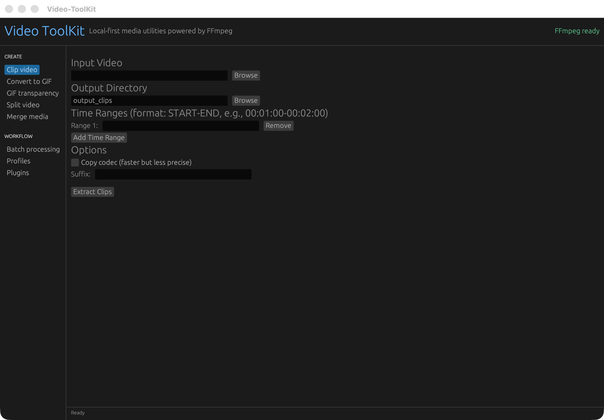

# Video Toolkit

**Practical FFmpeg workflows, from a desktop window or the command line.**

Clip recordings, replace audio, make GIFs and run repeatable batches locally. The Rust workspace shares processing code between an egui desktop interface and a CLI; reusable profiles keep settings consistent across both.

[v2.1.0 downloads](https://github.com/Alaneel/video-toolkit/releases/tag/v2.1.0) · [CLI and installation guide](#full-installation-and-usage-guide) · [Source](src) · [Tests](tests) · [Changes](CHANGELOG.md)



## What is here

| Workflow | Implementation |
| --- | --- |
| Extract timestamp ranges | [Clipper](crates/clipper) |
| Make palette-optimized GIFs with a size target | [GIF converter](crates/gif_converter) |
| Split video or replace its audio | [Splitter](crates/splitter) / [Merger](crates/merger) |
| Discover inputs and process batches | [Batch processing](crates/batch_processing) |
| Save and reuse settings | [Profile system](crates/profile_system) |
| Share validation and FFmpeg invocation | [Common layer](crates/common) |

FFmpeg and ffprobe must be installed separately for media conversion. Run without a subcommand to open the desktop app. GIF transparency can modify input files in place; review its backup option before use. Dynamically loaded plugins execute native code.

## Build and try

With stable Rust, your platform's native build dependencies, FFmpeg and ffprobe installed:

```bash
cargo run --release --locked -- --help
cargo run --release --locked
```

```bash
video-toolkit clipper recording.mp4 \
  --ranges 00:01:00-00:02:00 --output-dir clips

video-toolkit gif-converter demo.webm \
  --output demo.gif --width 480 --fps 10 --max-size 5 --optimize
```

For downloaded executables, use `./video-toolkit` on Linux/macOS or `.\video-toolkit.exe` in PowerShell. The published v2.1.0 release provides four native archives and `SHA256SUMS`; the full guide below covers platform dependencies, checksum verification and launch instructions.

## Engineering entry points

The [workspace manifest](Cargo.toml) maps the processing crates. [Tests](tests) include CLI and FFmpeg-backed integration cases; the latter need real runtime dependencies. [CI](.github/workflows/ci.yml) defines platform checks, and [packaging](.github/workflows/packages.yml) defines release builds.

```bash
cargo fmt --all -- --check
cargo clippy --workspace --all-targets -- -D warnings
cargo test --workspace --all-targets
cargo test --tests -- --ignored
```

See [CONTRIBUTING.md](CONTRIBUTING.md) before changing behavior. Code is released under [MIT](LICENSE); FFmpeg and other dependencies retain their own licenses. Packages are unsigned executables, and FFmpeg is not bundled.

## Full installation and usage guide

<details>
<summary>Open platform setup, checksums, CLI options, profiles and plugin notes</summary>

<!-- The existing detailed guide is retained below during the documentation refresh. -->

## Quick start

### Download a prebuilt binary

Prebuilt packages do **not** require Rust. Get the package for your operating system and CPU from [Releases](https://github.com/Alaneel/video-toolkit/releases), together with that release's `SHA256SUMS` file.

Tagged releases built by the current workflow use the archive/checksum layout below. Older releases such as v2.0.0 contain bare binaries instead. To try an unreleased build, use artifacts from a successful [release-packaging preview](https://github.com/Alaneel/video-toolkit/actions/workflows/packages.yml) or build from source. For a preview, download your `package-…` artifact and `release-checksums`, then extract GitHub's outer ZIP files to access the archive and `SHA256SUMS`.

| Your machine | Archive name for 2.1.0 |
| --- | --- |
| Linux, Ubuntu 22.04+ / compatible x86_64 desktop | `video-toolkit-2.1.0-x86_64-unknown-linux-gnu.tar.gz` |
| macOS, Apple Silicon (M1 or newer, `arm64`) | `video-toolkit-2.1.0-aarch64-apple-darwin.tar.gz` |
| macOS, Intel (`x86_64`) | `video-toolkit-2.1.0-x86_64-apple-darwin.tar.gz` |
| Windows, x64 | `video-toolkit-2.1.0-x86_64-pc-windows-msvc.zip` |

On macOS, check **About This Mac** to choose the native package; `uname -m` also reports the current terminal's architecture. Archives contain the executable, license, README, installation notes, and a build manifest. FFmpeg is not bundled.

#### Install the runtime dependencies

Media conversion needs both [FFmpeg and ffprobe](https://ffmpeg.org/download.html) in your `PATH`. Profile management and native GIF transparency can run without them.

On Ubuntu 22.04, install the desktop runtime and FFmpeg:

```bash
sudo apt update
sudo apt install libgtk-3-0 libxcb-shape0 libxcb-xfixes0 ffmpeg
```

Ubuntu 24.04 and newer use [`libgtk-3-0t64`](https://packages.ubuntu.com/noble/libgtk-3-0t64) in place of `libgtk-3-0`; use the package provided by your distribution. A graphical desktop is needed to open the GUI, but the CLI can run without a display.

On macOS with [Homebrew](https://formulae.brew.sh/formula/ffmpeg), install FFmpeg with `brew install ffmpeg`. On Windows, use a build linked from the [FFmpeg download page](https://ffmpeg.org/download.html#build-windows), then add its `bin` folder, containing both `ffmpeg.exe` and `ffprobe.exe`, to `PATH`. Open a new terminal after changing `PATH`.

Check both programs before processing media:

```bash
ffmpeg -version
ffprobe -version
```

#### Verify and launch

In the folder where you downloaded the archive and `SHA256SUMS`, calculate the archive's SHA-256 hash and compare it with the matching filename in `SHA256SUMS`. Proceed only if the entire hash matches. Checksums detect damaged or mismatched downloads; these packages are not signed installers.

```bash
# Linux
sha256sum video-toolkit-2.1.0-x86_64-unknown-linux-gnu.tar.gz

# macOS (Apple Silicon example; use x86_64-apple-darwin for Intel)
shasum -a 256 video-toolkit-2.1.0-aarch64-apple-darwin.tar.gz
```

```powershell
# Windows PowerShell
Get-FileHash .\video-toolkit-2.1.0-x86_64-pc-windows-msvc.zip -Algorithm SHA256
```

Extract the package, enter its folder, and run the executable. On Linux:

```bash
tar -xzf video-toolkit-2.1.0-x86_64-unknown-linux-gnu.tar.gz
cd video-toolkit-2.1.0-x86_64-unknown-linux-gnu
./video-toolkit --version
./video-toolkit --help
./video-toolkit
```

On macOS (Apple Silicon example):

```bash
tar -xzf video-toolkit-2.1.0-aarch64-apple-darwin.tar.gz
cd video-toolkit-2.1.0-aarch64-apple-darwin
./video-toolkit --version
./video-toolkit
```

macOS packages are unsigned command-line executables, not notarized `.app` bundles. Launch them from Terminal. macOS may ask you to approve a downloaded executable; review the package's source and checksum before using Apple's [**Privacy & Security** approval controls](https://support.apple.com/en-us/102445). Do not disable Gatekeeper globally. If your security policy forbids unsigned downloads, build from source instead.

On Windows PowerShell:

```powershell
Expand-Archive .\video-toolkit-2.1.0-x86_64-pc-windows-msvc.zip -DestinationPath .
Set-Location .\video-toolkit-2.1.0-x86_64-pc-windows-msvc
.\video-toolkit.exe --version
.\video-toolkit.exe --help
.\video-toolkit.exe
```

Running without a subcommand opens the native desktop app. To use the CLI examples below from the extracted folder, replace `video-toolkit` with `./video-toolkit` on Linux/macOS or `.\video-toolkit.exe` in PowerShell. Alternatively, add the executable's folder to `PATH`.

### Build from source

Install the latest stable [Rust toolchain](https://www.rust-lang.org/tools/install) and the runtime dependencies above. Source builds also need your platform's native compiler/linker. On Ubuntu, install the development libraries used by the desktop UI:

```bash
sudo apt update
sudo apt install build-essential pkg-config libgtk-3-dev libxcb-shape0-dev libxcb-xfixes0-dev ffmpeg
```

```bash
git clone https://github.com/Alaneel/video-toolkit.git
cd video-toolkit
cargo run --release --locked
```

To build a standalone binary:

```bash
cargo build --release --locked
./target/release/video-toolkit --help
```

On Windows, the built executable is `target\release\video-toolkit.exe`. Prebuilt releases are the simpler choice if you do not already have a Rust development environment.

## CLI examples

```bash
# Extract two clips
video-toolkit clipper video.mp4 \
  --ranges 00:01:00-00:02:00 00:05:30-00:06:15 \
  --output-dir clips

# Export clips as WebM with compatible VP9/Opus encoding
video-toolkit clipper video.mp4 --ranges 00:00-00:15 \
  --output-dir web-clips --format webm

# Convert a WebM to a palette-optimized GIF targeting 5 MB (may fail if unattainable)
video-toolkit gif-converter demo.webm \
  --output demo.gif --width 480 --fps 10 --max-size 5 --optimize

# Merge a video with a replacement audio track
video-toolkit merger video.mp4 soundtrack.mp3 \
  --output final.mp4 --shortest

# Process a folder recursively
video-toolkit batch clipper ./recordings --recursive \
  --ranges 00:00-00:15 --output-dir highlights

# Explore the complete command surface
video-toolkit --help
video-toolkit formats
```

Every command is also available through Cargo during development by replacing `video-toolkit` with `cargo run --release --`.

Choose an output container with `--format` for clip, split, and their batch commands: `mp4` (default), `mkv`, `avi`, `mov`, `webm`, `flv`, `wmv`, `ts`, `m4v`, `mpeg` (or `mpg`), `vob`, and `ogv`. The desktop clip, split, and batch tools offer the same selection. FFmpeg must include the corresponding encoders. Defaults select compatible video/audio codecs; AVI, WMV, MPEG, and VOB use stereo audio, and MPEG/VOB use 25 fps. `--copy-codec` preserves the source codecs, which must already be supported by the chosen container. Custom split encoding options replace the default codecs.

The merger infers its container from `--output final.webm`, or accepts `--format webm` with a matching extension. Without an extension, it adds the requested extension (MP4 by default). Conflicting extensions and unknown formats are rejected before processing. The output always uses the video from the first input and the audio from the selected audio source. Batch slices include the source filename, for example `recording_slice_1.mkv`, so different source filenames keep separate outputs. Repeated inputs are processed once; different inputs with conflicting output names are rejected before any output is created. Rename those sources or run them into separate output directories.

## Reusable profiles

Save a preset once, then apply it to different inputs:

```bash
video-toolkit profile create web-preview --profile-type clipper \
  --params 'ranges=0-00:15,00:30-00:45' 'format=webm' \
  'output_dir=previews' 'recursive=true' 'parallel=false'

video-toolkit batch with-profile ./recordings \
  --profile web-preview --profile-type clipper

# Override this run without changing the saved preset
video-toolkit batch with-profile ./recordings \
  --profile web-preview --profile-type clipper \
  --output-dir review-clips --recursive=false --parallel=true \
  --pattern '\.mp4$'

# Export and import portable JSON presets
video-toolkit profile export web-preview --profile-type clipper --output web-preview.json
video-toolkit profile import web-preview.json
```

In the desktop app, open **Profiles**, select or create a preset, and choose **Use in Batch**. The app loads its settings into Batch Processing; choose inputs, review or adjust the settings, and start the job. Loading a preset does not start processing or change the saved preset.

Profiles use the following parameters and defaults. Numbers must be positive (`max_size` must also be finite), booleans are `true`/`false`, and unknown keys or conflicting aliases are rejected before processing.

| Profile type | Required parameters | Optional parameters and defaults |
| --- | --- | --- |
| `clipper` | `ranges`: comma- or space-separated `START-END` ranges | `output_dir=output_clips`, `format=mp4`, `copy_codec=false`, `suffix` |
| `gif_converter` | None | `width` (up to 480 px by default), `fps=10`, `max_size=5.0` MB, `optimize=false`, `output_dir=output_gifs` |
| `gif_transparency` | None | `backup=false`; modifies the input GIFs in place |
| `splitter` | None | `output_dir=output_slices`, `prefix=slice`, `format=mp4`, `custom_encode`, `force=false` |
| `merger` | `audio`: audio file or source-video path | `output_dir=output_merged`, `format=mp4`, `shortest=false`, `copy_codec=false` |

Every profile also accepts `recursive=false`, `parallel=true`, and `pattern` (an optional filename regex). Regex whitespace is preserved; an empty value disables filtering. Relative audio and output paths are resolved from the working directory when the job runs. With GIF optimization enabled, conversion starts at the requested width/FPS and may reduce them to meet the size limit. GIF transparency with `backup=true` preserves the original in a `.gif.bak` file and keeps that first backup on repeated runs.

The aliases `time_ranges`, `max_size_mb`, `create_backup`, `audio_file`, `use_shortest`, `output_format`, and `encode_options` correspond to `ranges`, `max_size`, `backup`, `audio`, `shortest`, `format`, and `custom_encode`. Supply one key from each pair. Empty optional `width`, `suffix`, `custom_encode`, and `pattern` values are allowed; required fields cannot be blank. Custom profile types can be stored and exported, but cannot be run by the built-in batch tools.

Profiles normally use the platform's application configuration directory. Use the global `--profiles-dir ./presets` option to select a portable storage directory for CLI commands or the desktop app. Profile names and custom type names must be portable filename components; imported metadata must match its stored name and type. Profile management and native GIF transparency remain available without FFmpeg. A missing input, invalid preset, empty match set, or failed media job returns a nonzero CLI exit status.

## Architecture

Video Toolkit is a Rust workspace with small, focused crates:

```text
video-toolkit
├── src/                    GUI/CLI entry point
├── crates/
│   ├── common             FFmpeg process, formats, validation, errors
│   ├── clipper            timestamp-based extraction
│   ├── gif_converter      palette generation and size optimization
│   ├── gif_transparency   batch GIF processing
│   ├── splitter           vertical video slicing
│   ├── merger             audio extraction and media merging
│   ├── batch_processing   discovery, filtering, and parallel execution
│   ├── profile_system     persistent reusable settings
│   ├── plugin_system      dynamic plugin API and loader
│   └── ui                 egui desktop interface
└── plugins/
    └── watermark_plugin   reference plugin implementation
```

The processing crates depend on the shared `common` layer and remain independent of the GUI, so the same behavior is available from desktop and command-line workflows.

## Plugins

Plugins are dynamic libraries implementing the `Plugin` trait from `plugin_system`. Start with [`plugins/watermark_plugin`](plugins/watermark_plugin) as a working reference, build it in release mode, and place the resulting library in the platform plugin directory shown by the app.

Because loading a dynamic library executes native code, only install plugins you trust.

## Development

```bash
cargo fmt --all -- --check
cargo clippy --workspace --all-targets -- -D warnings
cargo test --workspace --all-targets
# Requires FFmpeg/ffprobe: encode real fixtures, exercise the CLI, and probe outputs
cargo test --tests -- --ignored
```

CI checks formatting and Clippy on Linux and runs workspace tests on Linux, macOS, and Windows. Linux also executes real FFmpeg integration tests that verify containers, codecs, replacement audio, batch outputs, and saved-profile processing. Dependency-free CLI tests verify profile storage and native GIF workflows with FFmpeg removed from `PATH`. See [CONTRIBUTING.md](CONTRIBUTING.md) for the contribution workflow, and [CHANGELOG.md](CHANGELOG.md) for release history.

The release workflow builds explicit Linux x86_64, macOS Intel, macOS Apple Silicon, and Windows x64 targets. It packages executables on their build machines, verifies extracted archives before upload, and checks version tags against the Cargo package version. Preview runs do not publish releases; a matching version tag produces the archives and `SHA256SUMS` on the Releases page.

</details>
